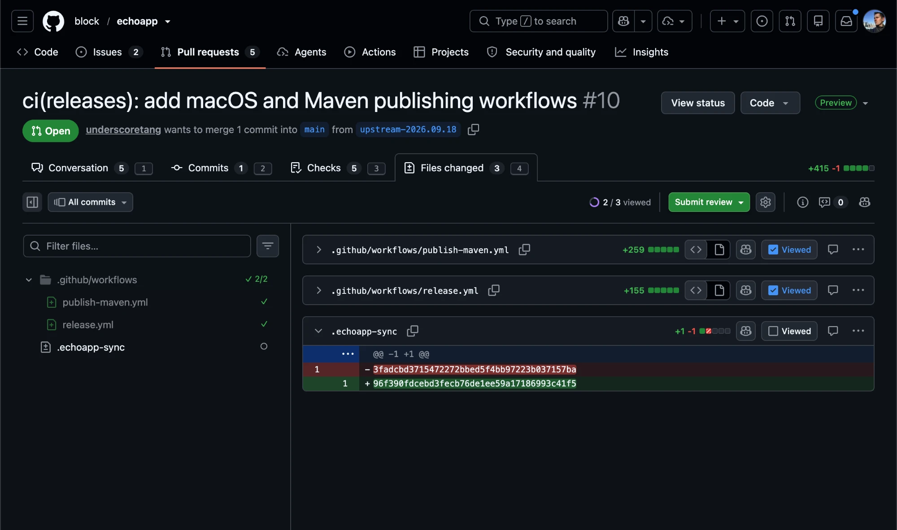

# My Better GitHub

A small browser extension for Chrome and Safari that makes reviewing pull
requests on GitHub a little faster:

- **Tab shortcuts.** Press `1`–`4` to jump between a PR's tabs.
- **File shortcuts.** Press `j` and `k` to move between files, and `v` to
  mark a file as **Viewed**.
- **Review progress in the file tree.** The **Files changed** tree shows which
  files you've marked as **Viewed**, and how many are left in each directory.

It has no settings, requests no extension permissions, and sends no data
anywhere. See [Privacy](#privacy).



## Features

### Tab shortcuts

On any pull request page:

| Key | Tab           |
|-----|---------------|
| `1` | Conversation  |
| `2` | Commits       |
| `3` | Checks        |
| `4` | Files changed |

- Each tab shows a small key badge with its number, so you don't need to
  remember them.
- Switching uses GitHub's own tab links, so the page doesn't fully reload.
- Shortcuts are ignored while you type in a comment box or other input, and
  when Ctrl, Cmd, or Alt is held, so they don't clash with browser or GitHub
  shortcuts.

### File shortcuts

On a PR's **Files changed** tab:

| Key | Action                                          |
|-----|-------------------------------------------------|
| `j` | Select the next file                            |
| `k` | Select the previous file                        |
| `v` | Toggle the selected file's **Viewed** checkbox  |

- The selected file has a blue outline, and its row in the file tree has a
  blue background.
- When `v` marks a file viewed, GitHub collapses it. The collapsed file stays
  at the top of the screen, and the next file below it becomes selected.
  If GitHub hasn't rendered the next file yet, it's selected as soon as it
  appears. When `v` removes the mark, the selection and scroll position
  don't change.
- The first `j` or `k` selects the file at the top of the screen.
- Clicking inside a file, or on its row in the file tree, also selects it.
  If you click a file in the tree and GitHub hasn't rendered it yet, `j`, `k`,
  and `v` do nothing until it appears, for up to 10 seconds.
- Like the tab shortcuts, these are ignored while you type and when Ctrl,
  Cmd, or Alt is held.

### Viewed state in the file tree

On a PR's **Files changed** tab, the file tree on the left mirrors each file's
**Viewed** checkbox and updates as you toggle it:

| Row                          | Looks like                     |
|------------------------------|--------------------------------|
| File not viewed yet          | `○` on the right               |
| Viewed file                  | Dimmed, green `✓`              |
| Directory, partly viewed     | Count of viewed files, `3/9`   |
| Directory, fully viewed      | Dimmed, green `✓ 9/9`          |

Directory counts include every file under that directory, including files in
collapsed subdirectories and diffs GitHub hasn't loaded yet.

You need to be signed in to GitHub, since the **Viewed** checkbox only exists
for signed-in users.

## Install

The extension isn't in the Chrome Web Store or the App Store. Install it from
source. First clone this repository, or download it as a ZIP and unzip it.

The quickest way is the install script. It asks which browser you want, then
does as much of the work as that browser allows:

```sh
./install.sh
```

You can also name the browser: `./install.sh chrome` or `./install.sh safari`.

### Chrome

Chrome loads the extension straight from the `extension/` folder. The script
copies that folder's path to your clipboard and opens `chrome://extensions`,
since Chrome has no way to load an unpacked extension from a script. To do it
by hand:

1. Open `chrome://extensions` in Chrome.
2. Turn on **Developer mode** (top right).
3. Click **Load unpacked** and select the `extension/` folder.
4. Refresh any GitHub tabs that were already open.

It should also work in other Chromium-based browsers that support loading
unpacked extensions, such as Edge, Brave, and Arc. It's only tested in Chrome.

### Safari

Safari runs web extensions only inside a macOS app, so `safari/` holds a small
Xcode project that wraps the same `extension/` folder. The app runs on macOS 14
or later. Building it needs Xcode 27 or later. `./install.sh safari`:

1. Builds the app with `xcodebuild`, signed with the team of the first
   **Apple Development** certificate in your keychain. Set `MBG_TEAM_ID` to
   pick a team, or to `none` to sign for local use only.
2. Copies **My Better GitHub.app** to `/Applications`, or to `~/Applications`
   when `/Applications` isn't writable. Set `MBG_INSTALL_DIR` to choose.
3. Opens the app once, so Safari lists the extension.

Then, in Safari:

1. Choose **Safari > Settings > Extensions** and turn on **My Better GitHub**.
2. Allow it on github.com when Safari asks. Safari asks per site, where
   Chrome doesn't.
3. Refresh any GitHub tabs that were already open.

Without a development team, Safari hides the extension until you turn on
**Develop > Developer Settings > Allow unsigned extensions**, and it turns
that off again when it quits. A signed build avoids this. A free Apple
Developer account is enough, since no App Store or notarization step is
involved.

You can also open `safari/My Better GitHub.xcodeproj` in Xcode, pick your
team under **Signing & Capabilities**, and run it.

If Safari lists the extension twice, macOS knows two copies of the app. A
build in Xcode's DerivedData folder is the usual second one. Delete that
copy, then quit and reopen Safari. The install script deletes its own build
copy after each install for this reason.

### Update

Pull the latest changes (or download them again). Then:

- **Chrome:** click the reload icon on the extension's card in
  `chrome://extensions`.
- **Safari:** run `./install.sh safari` again.

Then refresh your GitHub tabs.

If you installed in Chrome before version 1.3.3, the extension's card points at
the repository root, and reloading fails with "Manifest file is missing or
unreadable" now that the code lives in `extension/`. Do this once: click
**Remove** on the card, then **Load unpacked** and select `extension/`. Later
updates reload as usual.

## Privacy

- The extension runs only on `https://github.com/*`.
- It requests no extension permissions and stores nothing.
- It makes no requests to any server other than GitHub. On the **Files
  changed** tab it may re-fetch the page you're on from github.com, to read
  which files are viewed after an in-page navigation.
- In Safari, the extension asks for permission to run on github.com, as every
  Safari extension does for the sites it uses. The macOS app that wraps it
  does nothing but show how to turn the extension on.

## Limitations

The extension reads GitHub's page structure, which GitHub can change at any
time. If a feature stops working, GitHub most likely changed its markup.

- The file shortcuts and the file tree feature support GitHub's current
  **Files changed** view (`/pull/<number>/changes`). They don't support
  GitHub's older, classic files view.
- Safari is supported on macOS only. There is no iOS or iPadOS build.

## Development

The extension itself has no build step. It's plain JavaScript and CSS in
`extension/`, and one copy of the code serves both browsers because it uses
no `chrome.*` or `browser.*` APIs:

| File                          | Purpose                                            |
|-------------------------------|----------------------------------------------------|
| `extension/manifest.json`     | Extension manifest (Manifest V3).                  |
| `extension/content.js`        | Tab shortcuts, and tags tabs for their key badges. |
| `extension/tab-shortcuts.css` | Styles for the key badges on the tabs.             |
| `extension/viewed-tree.js`    | Tracks viewed state and tags file tree rows.       |
| `extension/viewed-tree.css`   | Styles for the tagged file tree rows.              |
| `extension/file-nav.js`       | File shortcuts: `j`, `k`, and `v`.                 |
| `extension/file-nav.css`      | Styles for the selected file.                      |
| `extension/icons/`            | The icon, as PNGs. See [Icon](#icon).              |

The rest of the repository supports it:

| Path         | Purpose                                                              |
|--------------|----------------------------------------------------------------------|
| `install.sh` | Installs the extension in Chrome or Safari. See [Install](#install). |
| `safari/`    | Xcode project that wraps `extension/` in a macOS app for Safari.     |
| `scripts/`   | `make-icons.js`, which draws the icon. See [Icon](#icon).            |
| `tests/`     | Playwright tests. See [Tests](#tests).                               |

After you edit a file, reload the extension:

- **Chrome:** click the reload icon on the extension's card in
  `chrome://extensions`.
- **Safari:** run `./install.sh safari` to rebuild and reinstall the app.

Then refresh any open GitHub tabs.

The Safari project was generated with `xcrun safari-web-extension-converter`
and then flattened into `safari/`. It references the files in `extension/` one
by one, and the `icons/` folder as a whole, so if you add a file at the top of
`extension/`, also add it to the **My Better GitHub Extension** target's
resources in Xcode. When you bump `version` in
`manifest.json`, bump `MARKETING_VERSION` in the Xcode project to match. The
install script always builds with the manifest's version.

### Icon

The icon is a dark key cap with a green check mark, after the key badges on
the PR tabs and the Viewed mark in the file tree. `scripts/make-icons.js`
draws it as SVG and renders every PNG with the Chromium that Playwright
installs. `docs/icon.svg` is a copy of the drawing. After you change the
drawing, run:

```sh
npm run icons
```

It writes `extension/icons/`, which both browsers read through the manifest,
the macOS app icon set in `safari/`, and the icon the app's window shows.

To log what the file shortcuts do, run `localStorage.mbgDebug = "1"` in the
DevTools console on a GitHub page, then reload. The lines start with `[mbg]`.

### Tests

The extension itself has no dependencies. The tests need Node.js:

```sh
npm install
npx playwright install chromium
npm test
npm run lint
```

`npm test` starts Chromium with the real extension loaded, on a fake
`github.com` from `tests/support/`. It needs no network or GitHub account, and
CI runs it on each pull request. Playwright can't load Safari extensions, so
the tests cover Chromium only. Check Safari by hand after
`./install.sh safari`.

The fake page can't show that GitHub changed its real page. To check that, run
the live tests. Sign in once, then run them when you like, or when a feature
stops working:

```sh
npm run test:live:login
npm run test:live
```

The live tests skip themselves if there is no saved session. They read a public
PR and never change its **Viewed** state. The session is saved in `.auth/`,
which git ignores. If a live test fails, update the extension and
`tests/support/fake-github-page.js` to match GitHub's new page.

All content scripts run on all of `github.com`, not just PR URLs. GitHub
navigates between pages without full reloads, so a script limited to PR URLs
wouldn't load if you arrived at a PR from another GitHub page.

## License

[MIT](LICENSE)
