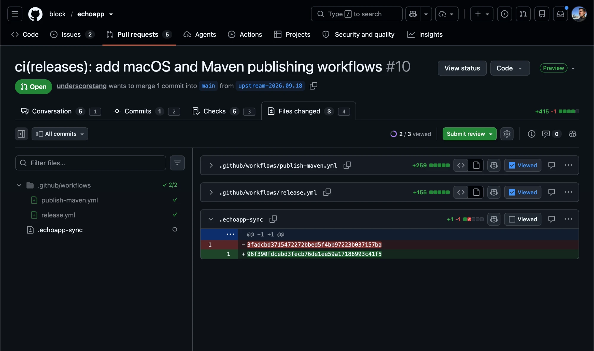

# My Better GitHub

A small Chrome extension that makes reviewing pull requests on GitHub a little
faster:

- **Tab shortcuts.** Press `1`–`4` to jump between a PR's tabs.
- **File shortcuts.** Press `j` and `k` to move between files, and `v` to
  mark a file as **Viewed**.
- **Review progress in the file tree.** The **Files changed** tree shows which
  files you've marked as **Viewed**, and how many are left in each directory.

It has no settings, requests no extension permissions, and sends no data
anywhere. See [Privacy](#privacy).



## Features

### Tab shortcuts

On any pull request page:

| Key | Tab           |
|-----|---------------|
| `1` | Conversation  |
| `2` | Commits       |
| `3` | Checks        |
| `4` | Files changed |

- Each tab shows a small key badge with its number, so you don't need to
  remember them.
- Switching uses GitHub's own tab links, so the page doesn't fully reload.
- Shortcuts are ignored while you type in a comment box or other input, and
  when Ctrl, Cmd, or Alt is held, so they don't clash with browser or GitHub
  shortcuts.

### File shortcuts

On a PR's **Files changed** tab:

| Key | Action                                          |
|-----|-------------------------------------------------|
| `j` | Select the next file                            |
| `k` | Select the previous file                        |
| `v` | Toggle the selected file's **Viewed** checkbox  |

- The selected file has a blue outline, and its row in the file tree has a
  blue background.
- When `v` marks a file viewed, GitHub collapses it. The collapsed file stays
  at the top of the screen, and the next file below it becomes selected.
  If GitHub hasn't rendered the next file yet, it's selected as soon as it
  appears. When `v` removes the mark, the selection and scroll position
  don't change.
- The first `j` or `k` selects the file at the top of the screen.
- Clicking inside a file, or on its row in the file tree, also selects it.
  If you click a file in the tree and GitHub hasn't rendered it yet, `j`, `k`,
  and `v` do nothing until it appears, for up to 10 seconds.
- Like the tab shortcuts, these are ignored while you type and when Ctrl,
  Cmd, or Alt is held.

### Viewed state in the file tree

On a PR's **Files changed** tab, the file tree on the left mirrors each file's
**Viewed** checkbox and updates as you toggle it:

| Row                          | Looks like                     |
|------------------------------|--------------------------------|
| File not viewed yet          | `○` on the right               |
| Viewed file                  | Dimmed, green `✓`              |
| Directory, partly viewed     | Count of viewed files, `3/9`   |
| Directory, fully viewed      | Dimmed, green `✓ 9/9`          |

Directory counts include every file under that directory, including files in
collapsed subdirectories and diffs GitHub hasn't loaded yet.

You need to be signed in to GitHub, since the **Viewed** checkbox only exists
for signed-in users.

## Install

The extension isn't in the Chrome Web Store. Load it from source:

1. Clone this repository, or download it as a ZIP and unzip it.
2. Open `chrome://extensions` in Chrome.
3. Turn on **Developer mode** (top right).
4. Click **Load unpacked** and select the repository folder.
5. Refresh any GitHub tabs that were already open.

It should also work in other Chromium-based browsers that support loading
unpacked extensions, such as Edge, Brave, and Arc. It's only tested in Chrome.

### Update

Pull the latest changes (or download them again), then click the reload icon
on the extension's card in `chrome://extensions` and refresh your GitHub tabs.

## Privacy

- The extension runs only on `https://github.com/*`.
- It requests no extension permissions and stores nothing.
- It makes no requests to any server other than GitHub. On the **Files
  changed** tab it may re-fetch the page you're on from github.com, to read
  which files are viewed after an in-page navigation.

## Limitations

The extension reads GitHub's page structure, which GitHub can change at any
time. If a feature stops working, GitHub most likely changed its markup.

- The file shortcuts and the file tree feature support GitHub's current
  **Files changed** view (`/pull/<number>/changes`). They don't support
  GitHub's older, classic files view.

## Development

There is no build step. The extension is plain JavaScript and CSS:

| File                | Purpose                                            |
|---------------------|----------------------------------------------------|
| `manifest.json`     | Extension manifest (Manifest V3).                  |
| `content.js`        | Tab shortcuts, and tags tabs for their key badges. |
| `tab-shortcuts.css` | Styles for the key badges on the tabs.             |
| `viewed-tree.js`    | Tracks viewed state and tags file tree rows.       |
| `viewed-tree.css`   | Styles for the tagged file tree rows.              |
| `file-nav.js`       | File shortcuts: `j`, `k`, and `v`.                 |
| `file-nav.css`      | Styles for the selected file.                      |

After you edit a file, click the reload icon on the extension's card in
`chrome://extensions`, then refresh any open GitHub tabs.

To log what the file shortcuts do, run `localStorage.mbgDebug = "1"` in the
DevTools console on a GitHub page, then reload. The lines start with `[mbg]`.

### Tests

The extension itself has no dependencies. The tests need Node.js:

```sh
npm install
npx playwright install chromium
npm test
npm run lint
```

`npm test` starts Chromium with the real extension loaded, on a fake
`github.com` from `tests/support/`. It needs no network or GitHub account, and
CI runs it on each pull request.

The fake page can't show that GitHub changed its real page. To check that, run
the live tests. Sign in once, then run them when you like, or when a feature
stops working:

```sh
npm run test:live:login
npm run test:live
```

The live tests skip themselves if there is no saved session. They read a public
PR and never change its **Viewed** state. The session is saved in `.auth/`,
which git ignores. If a live test fails, update the extension and
`tests/support/fake-github-page.js` to match GitHub's new page.

All content scripts run on all of `github.com`, not just PR URLs. GitHub
navigates between pages without full reloads, so a script limited to PR URLs
wouldn't load if you arrived at a PR from another GitHub page.

## License

[MIT](LICENSE)
